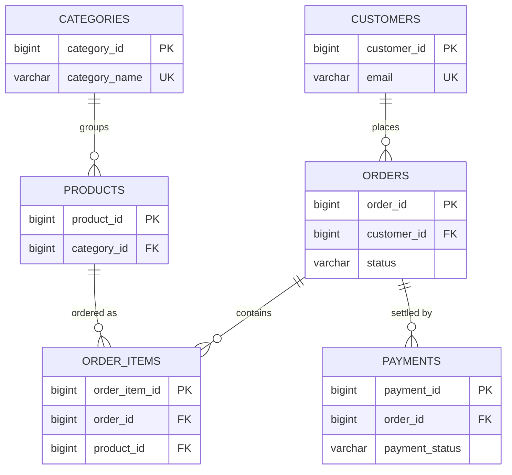

# Schema Intelligence: Naive Agent Version

A tool-calling agent that answers backend questions about a PostgreSQL schema, inspects tables, traces foreign-key paths, retrieves business definitions, and validates generated SQL with `EXPLAIN`. It never executes a query.

---

## 1. Problem Statement

**What problem.** A backend developer picks up a ticket "*add an order-history endpoint*, *add a delete-order endpoint*" and before writing any code has to answer a set of questions about a database they did not design: which table holds this value, how do orders reach products, can this column be null, which status values does the database actually accept, and will this query be fast on real data.

Those answers are not in one place. Part of them is in the schema and migrations, part in business documentation or a wiki that has drifted from the code, and part only in the query plan. Reconstructing them takes time on every ticket, it is worse for anyone new to the codebase, and it is worst for frontend developers pulled into backend work without the schema context a backend developer accumulates over months.

Getting it wrong is quiet rather than loud. Joining two one-to-many tables duplicates every total; forgetting a status filter inflates revenue; assuming a cascade exists produces a delete endpoint that fails in production. None of these throw an error at review time, they return plausible numbers and pass a smoke test.

**Why agentic.** Two simpler designs fail:

- *A single LLM call* does not know this schema. When it guesses it invents plausible columns and joins: the most expensive kind of wrong answer, because it looks right.
- *A static pipeline* cannot know what a given question needs. One needs a column list, another a three-hop join path, another a business definition, another a plan check. A fixed sequence either over-fetches every time or misses the step that matters.

So the model chooses the tools per question, reads each result, and decides what to do next, which is exactly a tool-calling loop.

**Tools.** Four, each doing one thing:

| Tool | Does one thing |
|---|---|
| `get_table_schema` | Columns, types, nullability, PK/FK/UNIQUE from `information_schema`, for one or many tables |
| `find_relationships` | Shortest FK join path between two tables (BFS), with join columns |
| `search_schema_docs` | Top-3 semantic matches from 18 Markdown docs (MiniLM-L6-v2, in-memory cosine) |
| `validate_sql` | Plans a single `SELECT`/`WITH` via `EXPLAIN (FORMAT JSON)`, read-only |

Mango 1.5-9B (Orion API) drives the loop: call tools, read results, repeat until an answer or five steps. Every tool is read-only.

---

## 2. Links

- **GitHub:** [github.com/dannykhant/schema-intelligence](https://github.com/dannykhant/schema-intelligence)
- **Notebook:** [`notebooks/naive_agent.ipynb`](https://github.com/dannykhant/schema-intelligence/blob/main/notebooks/naive_agent.ipynb)

---

## 3. Schema

The seeded database: 6 tables, 5 foreign keys. Key columns only, full column lists are in the notebook.



`status` ∈ `pending, processing, completed, cancelled`. `payment_status` ∈ `paid, pending, failed, refunded`. All five FKs are `ON DELETE NO ACTION`, so deleting a parent with children is blocked, not cascaded. (A2 gets this wrong.)

---

## 4. Usage Summary

**Data source.** PostgreSQL 17 in Docker, seeded with 8 customers, 12 orders, 17 order items, 12 payments. Plus 18 Markdown documents for RAG.

**Setup.**

```bash
git clone https://github.com/dannykhant/schema-intelligence && cd schema-intelligence

cp -n .env.example .env     # set POSTGRES_PORT if 5432 is taken; add ORION_API_KEY + ORION_BASE_URL

docker compose up -d        # seeds schema + data on first start

uv sync && uv sync --group dev
.venv/bin/python -m ipykernel install --user --name schema-intel --display-name "schema-intel (.venv)"
```

**Run.** Open `notebooks/naive_agent.ipynb` with the `schema-intel` kernel, run all cells. Sections 1-10 build the parts; 11 runs the queries live; 12 grades them.

**Grading** (`evaluation/evaluate.py`, computed not hand-written):

- Answer contains SQL → execute it read-only, compare rows to `evaluation/ground_truth.json`.
- Prose answer → required/forbidden keyword groups.
- Cosine similarity to a reference answer → flag only, never decisive.

Ground truth is generated from the live database. Seed dates are relative to container init, so re-seeding invalidates it:

```bash
.venv/bin/python evaluation/build_ground_truth.py
```

---

## 5. Failure Log and Analysis

Eight queries, one to five tool calls each. Five pass, three fail. Graded programmatically, then re-read by hand. The IDs match the notebook: **A1-A3** are set 11a (schema and constraints), **B1-B3** set 11b (writing queries), **C1-C2** set 11c (debugging and performance). The difficulty range still runs from a single call (A1, C2) to five (A2).

### A1 · Constraints and allowed values · 1 call · ❌

> *What columns, types and constraints does the payments table have? I need to know whether amount is nullable and which payment_status values are allowed.*

**Tools:** `get_table_schema`

**Wrong.** Got `amount IS NOT NULL` right, then asserted *"the database doesn't show a CHECK constraint that would limit `payment_status`"*. The database has one; the tool just doesn't return CHECK constraints. It never answered which values are allowed, and closed by asking *"Would you like me to search the documentation…?"*

**Why.** Two mistakes: reporting a tool limitation as a database property, and asking permission to use `search_schema_docs` instead of calling it. One extra call would have produced the four allowed values.

---

### A2 · Delete-order dependencies · 5 calls · ❌

> *I'm writing a delete-order endpoint. Which tables and columns reference orders, and what should I handle before deleting an order row?*

**Tools:** `get_table_schema` → `find_relationships` → `find_relationships` → `search_schema_docs` → `search_schema_docs`

**Wrong, and dangerous.** It found both references (`order_items.order_id`, `payments.order_id`), then recommended `ALTER TABLE ... DROP CONSTRAINT ... CASCADE` as a "cascade delete" (it drops the constraint, not the child rows), and `UPDATE order_items SET order_id = NULL` on a `NOT NULL` column, which cannot execute. It never stated the real answer: both FKs are `NO ACTION`, so the delete is blocked until children are removed or reassigned.

**Why.** No tool exposes FK delete rules and the knowledge base has no delete document, so two searches returned nothing. It filled the gap with invented DDL.

---

### A3 · Nullability for SUM · 2 calls · ✅

> *Is order_items.unit_price_at_purchase nullable? I want to SUM it in a revenue report. Will NULLs be a problem?*

**Tools:** `get_table_schema` → `search_schema_docs`

**Correct.** The column is `NOT NULL`, so no NULLs and no `COALESCE` needed; it gave a valid aggregate as an example.

**Note.** Clean answer, and it confirmed this is the historical price rather than `products.current_price`, the distinction the knowledge base warns about.

---

### B1 · Order-history totals · 3 calls · ✅

> *Write a query for the order-history endpoint: each order with its total item value. An order can have multiple payments, and the totals must not be duplicated.*

**Tools:** `get_table_schema` → `search_schema_docs` → `validate_sql`

**Correct.** All 12 rows match expected totals.

**Note.** It retrieved the join-multiplication guidance, then pre-aggregated `order_items` in a CTE *before* joining payments, so the item total cannot be multiplied by payment rows. It also added an unrequested `SUM(p.amount)` column: harmless, but drift.

---

### B2 · Customers who never ordered · 2 calls · ✅

> *Write a query returning customers who have never placed an order, with id, name and email.*

**Tools:** `get_table_schema` → `validate_sql`

**Correct.** `LEFT JOIN orders … WHERE orders.customer_id IS NULL`. Executed: 0 rows, matching ground truth: every customer in the seed has at least one order.

**Note.** It cited a `Hash Right Anti Join` from the plan, which is what PostgreSQL produces for this shape, and did not invent a row count.

---

### B3 · Keyset pagination · 2 calls · ❌

> *Write a keyset-pagination query for the orders table: the next 5 orders after the cursor (order_date = 2026-10-07, order_id = 3), newest first, stable across pages.*

**Tools:** `get_table_schema` → `validate_sql`

**Wrong.** Produced `WHERE order_date > '2026-10-07' OR (order_date = '2026-10-07' AND order_id > 3)` with `ORDER BY order_date DESC, order_id DESC`. Walking backwards through a descending list needs `<`. Executed: returns `[12, 8, 4, 2, 10]`; correct page is `[11, 6, 9]`.

**Why.** Valid SQL (`EXPLAIN` accepted it), with confident reasoning ("gets all rows strictly newer than the cursor"). The comparison direction is inverted relative to the sort. Validation cannot catch this: a query can plan correctly and still return the wrong rows.

---

### C1 · Duplicate payment amounts · 2 calls · ✅

> *This query returns duplicate payment amounts per order:*
> `SELECT o.order_id, p.amount FROM orders o JOIN payments p ON p.order_id = o.order_id JOIN order_items oi ON oi.order_id = o.order_id WHERE o.customer_id = 1;`
> *Why does it return duplicates, and how do I fix it?*

**Tools:** `get_table_schema` → `get_table_schema`

**Correct.** Named the cause (two one-to-many joins multiplying rows) and the fix: drop the `order_items` join. Executed: 2 rows, matching ground truth.

**Note.** Two caveats. It also suggested `DISTINCT`, which would hide genuine duplicate payment rows rather than fix the join. And it never called `validate_sql`, so the fix was never checked; it happened to be right.

---

### C2 · Index usage · 1 call · ✅

> *Will this query use the index on order_date? Read the execution plan and tell me.*
> `SELECT order_id, order_date FROM orders WHERE order_date >= CURRENT_DATE - INTERVAL '30 days' ORDER BY order_date DESC LIMIT 20;`

**Tools:** `validate_sql`

**Correct.** Reported `Index Scan`, `idx_orders_order_date`, direction `Backward`, and that the backward scan serves `ORDER BY ... DESC` without a sort. Matches the real plan.

**Note.** Index metadata is not exposed by any tool, so reading the plan was the only route and it took it.

---

## 6. Summary

Five of eight queries pass. The tool-calling loop itself works: it picks the right tools, in a sensible order, and stops when it has an answer. The three failures come from elsewhere:

- **A1** treated a tool's blind spot as a database fact, and offered to search the docs instead of searching.
- **A2** invented DDL when no tool could answer, producing advice that would fail if run.
- **B3** produced valid SQL that returns the wrong rows, invisible to `EXPLAIN`.

Two of the three trace back to what `get_table_schema` does not expose (CHECK constraints, FK delete rules); the third to validation being syntactic rather than semantic. Extending the schema tool and executing generated SQL against known data would remove all three; prompting alone would not fix B3. A fourth weakness is quieter: **C1** passed without ever calling `validate_sql`, so a correct answer came from luck as much as method.
